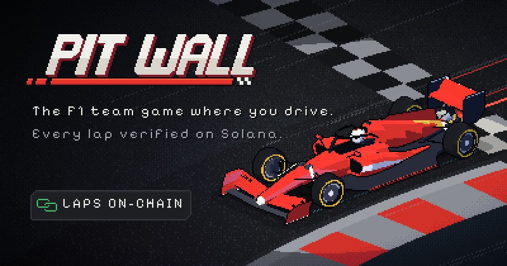
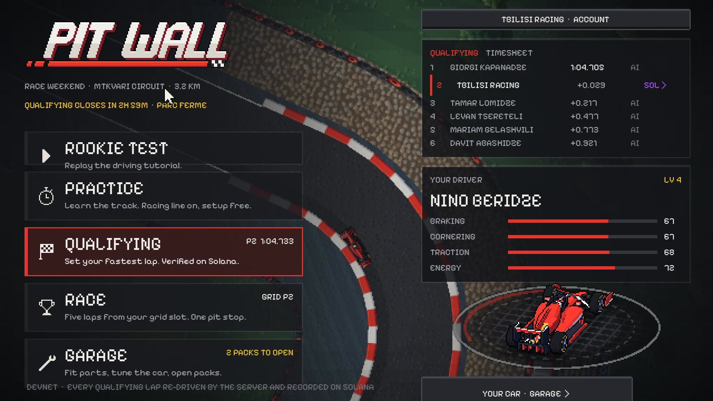
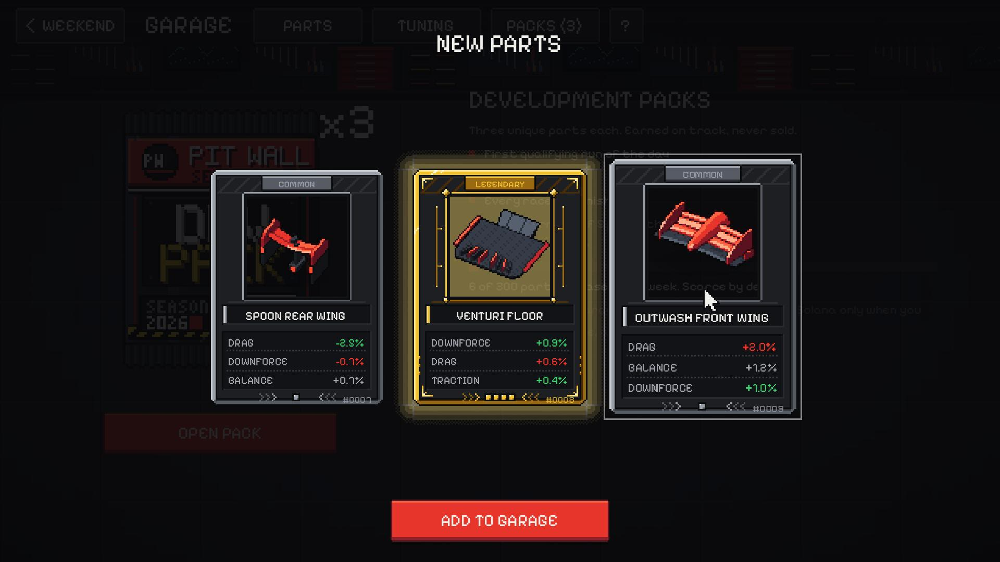
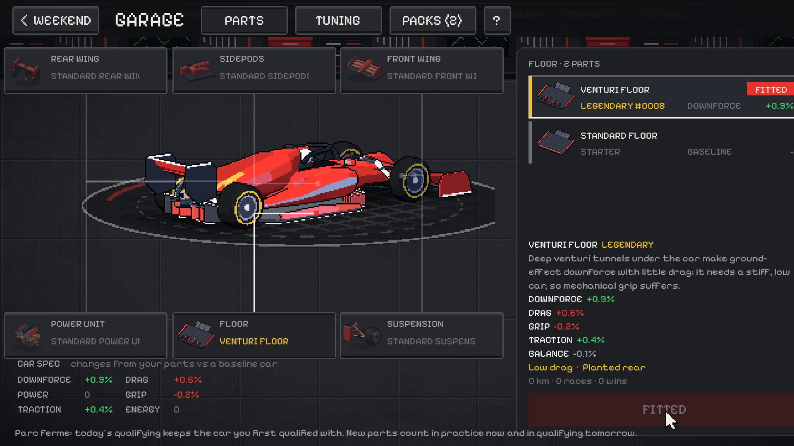
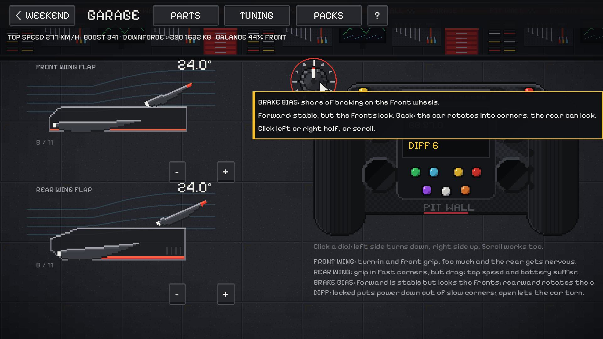
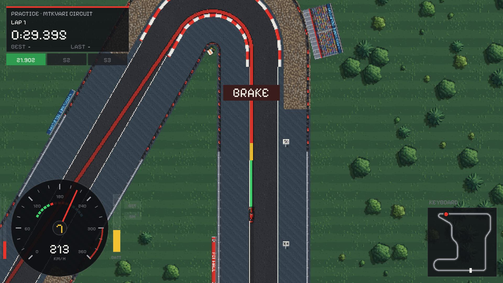
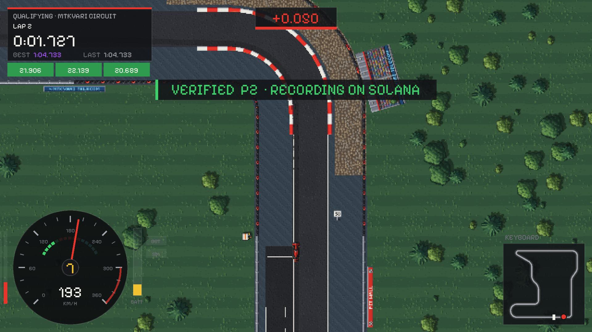
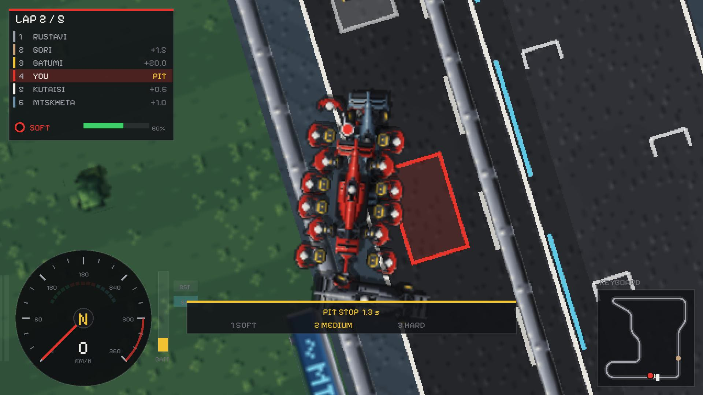
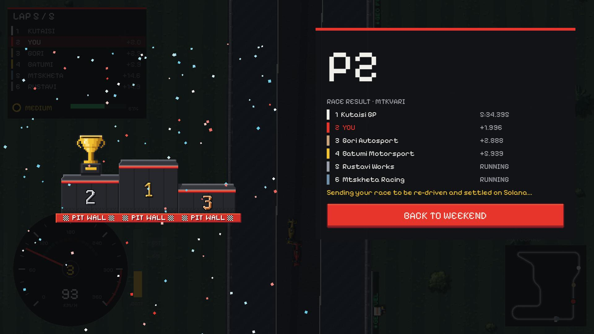

# Pit Wall



**An F1 team game where you also drive the car, and where driving well pays.** Fit parts you earn on
track, tune the setup, then qualify and race. Every lap you drive is re-driven by the server from
your inputs, with the same physics, and recorded on Solana. A time on the timesheet is a time someone
actually drove. Buy a race pass, race everyone on equal cars, and the fastest drivers split the pot,
paid out by the on-chain program.

**Play it free in your browser: [pitwall-game.fly.dev](https://pitwall-game.fly.dev)** (keyboard or controller, no wallet needed)

| | |
|---|---|
|  |  |
|  |  |
|  |  |
|  |  |

## What you can do

- **Rookie Test:** a two-minute driving tutorial. The garage has its own guided tour and tooltips.
- **Practice:** learn Mtkvari Circuit (fictional, 3.2 km). The racing line reads your speed: yellow
  means lift, red means brake now. Braking boards and coaching tips help too.
- **Qualifying:** one clean lap, no assists. Your first run locks the setup (parc fermé). Each
  personal best is sent to the server, which re-drives it from your inputs; only a matching lap
  counts, and it is recorded on Solana. You chase the ghost of the fastest other player, rebuilt
  from their verified inputs.
- **Race:** five laps from your qualifying slot against the AI field:
  - Use two tyre compounds and make one pit stop.
  - Drive into the pit lane under the 80 km/h limiter and stop in your box.
  - Your crew's skill decides how long you are stopped.
  - The whole race is re-driven on the server and the result is settled on Solana.
- **Race passes:** stake a pass from your wallet for a daily or weekly event (three stake tiers).
  - Everyone drives the same standard car, so only driving counts.
  - Your best verified lap in the event counts.
  - When the event closes, the Pit Wall program pays the top 20% from the pot. Each paid place
    gets at least 1.5x its stake, and Pit Wall keeps 10%.
  - With fewer than four entrants, everyone is refunded.
  - The program refuses to close a pool unless players received exactly the rest.
  - On devnet the stakes are devnet SOL; on mainnet they would be USDC.
- **Garage:** six part areas (front wing, rear wing, sidepods, floor, suspension, power unit).
  - Parts are unique cards with real engineering concepts, rolled stats, traits and a weight.
  - Each part changes how the car drives and how it looks, on the 3D car and on track.
  - The garage shows what a part does in real units, from the physics itself: top speed,
    cornering, braking distance, 0-200 and weight, in one plain sentence.
  - TEST DRIVE laps the circuit with and without the part and shows where it gains or loses time.
  - Parts wear out: their effect fades near the end of their life, and they retire.
  - Scrapping a part gives R&D credits. These sinks keep the parts market from flooding.
  - Tune wing flaps, brake bias and differential on the steering wheel.
- **Development packs:** three parts each. You earn them by driving (your first qualifying lap of
  the day, a top-3 qualifying time, every race you finish). They are never sold, and each week has a
  capped part supply.
- **Accounts:** play as a guest, or create a team name and password. You can link a Solana wallet
  by signing a message (no transaction, no fee) and sign in with it.

## How it is verifiable

- **Deterministic physics:**
  - The car physics in `game/sim/` uses whole-number 16.16 fixed point at 120 ticks per second,
    with a stored sine table.
  - There are no floats, so a lap driven in a browser re-drives to the exact microsecond on the
    server.
- **One implementation:** the server re-drives laps and races with headless Godot running the same
  scripts (`res://sim/redrive.gd`). Client and server physics cannot drift apart.
- **Per-attempt seeds:** each attempt gets a seed that slightly changes grip and wind, so a
  recording from one attempt does not replay in another.
- **Real-time check:** a run cannot contain more ticks than the time since its seed was issued.
- **On-chain record:** the Anchor program (`programs/pitwall`) is on devnet at
  `FRMukL3ubSZcGHxAFjK1ywSqfY3bWod2ro1ySoULwH4r`. It stores:
  - each player's best lap per event (time, input hash, physics version);
  - races, with the seed committed before the start and revealed after, plus entries and results;
  - drivers' experience;
  - race-pass pools: stakes in, payouts by placing, Pit Wall's capped share out.

  A lap record costs a 0.000005 SOL fee.

## Controls

| | Keyboard | Controller |
|---|---|---|
| Throttle | W / Up | Right trigger |
| Brake | S / Down / Space | Left trigger |
| Steer | A D / Left Right | Left stick |
| Boost | Shift / E | A / Right bumper |
| Reverse | X | B |
| Restart lap | R | Y |
| Pause | Esc / P | Start |

In a race, press 1, 2 or 3 to choose the tyre for your pit stop. C changes the camera.

## Run it locally

You need Godot 4.7.2, Node 24 or newer with pnpm, and Python 3 (for the generators).

```bash
pnpm install
python tools/make_track.py                       # circuit data, racing line, sine table
tools/build-web.cmd                              # export the Godot web build to build/web/
cd server && GODOT_BIN=/path/to/godot RPC_URL=https://api.devnet.solana.com node src/index.ts
```

Open http://localhost:8787.
- The server signs Solana transactions with the keypair at `~/.config/solana/id.json` (or the path
  in `AUTHORITY_KEYPAIR`). Use a devnet keypair with some devnet SOL.
- If a chain call fails, the lap still counts as verified; it just has no transaction.

Tests:

```bash
cd packages/sim && node --test test/*.test.ts                 # race sim, golden result
cd server && node --test test/*.test.ts                       # accounts, parts, packs, supply cap, races
cargo test -p pitwall                                         # Anchor program (LiteSVM)
godot --headless --path game -s res://sim/test_drive.gd       # physics: autopilot laps + exact re-drive
godot --headless --path game -s res://sim/test_race.gd        # race: AI field, pit stops, exact re-drive
```

## Project layout

| Path | What it is |
|---|---|
| `game/` | The Godot 4.7 game (typed GDScript). `game/sim/` holds the deterministic physics, race and AI shared with the server. |
| `server/` | Node/TypeScript API: attempts, re-drives, races, parts and packs, accounts, Solana transactions. |
| `programs/pitwall/` | The Anchor program (Rust). |
| `packages/sim/` | The deterministic race-strategy simulation in TypeScript. |
| `tools/art`, `tools/audio`, `tools/brand` | Generators for every sprite, sound and brand image. |
| `deploy/`, `Dockerfile`, `fly.toml` | Deployment to Fly.io ([deploy/README.md](deploy/README.md)). |
| `docs/` | [Design](docs/DESIGN.md), [economy](docs/ECONOMY.md), [plan](docs/PLAN.md), [architecture](docs/ARCHITECTURE.md). |

## Licence

View only: all rights reserved, see [LICENSE](LICENSE). You are welcome to read the code; please ask before reusing any of it.

## Assets

- **Art:** every sprite (cars, part cards, packs, track textures, scenery, UI), the 3D car and the
  brand kit are generated by code (`tools/art/`, `tools/brand/`, `game/scenes/car3d/`). There is no
  third-party art.
- **Sound and music:** synthesised from scratch by the scripts in `tools/audio/`, with no samples.
- **Font:** Pixelify Sans, SIL Open Font License 1.1 (`game/assets/fonts/OFL.txt`).
- **Engine:** Godot, MIT licence.
- **Names:** circuits, teams, drivers and sponsors are fictional. There are no real F1 teams,
  drivers, circuits or brands.
